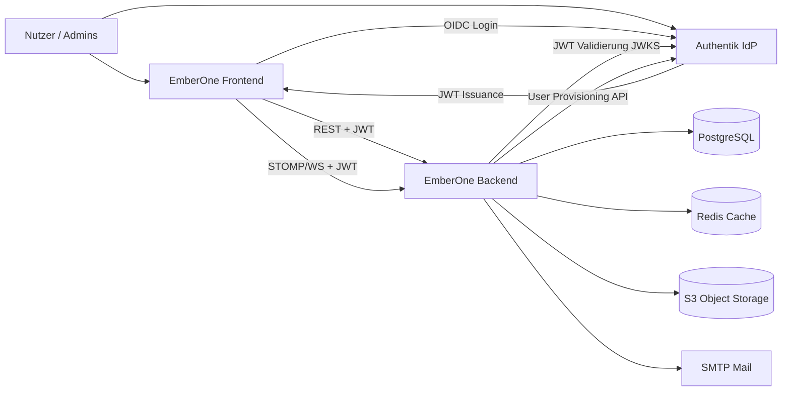

# 3. Kontext und Scope

## 3.1 Fachlicher Kontext

EmberOne ist das System der Wahrheit für Organisationsstruktur, Mitgliedschaften, Freigabeprozesse und Personalnachweise eines Mandanten. Externe Systeme übernehmen Identität, Dateiablage und Mail-Transport - nicht die Fachlogik.

| Nachbar | Fachliche Beziehung |
|---------|---------------------|
| **Authentik** | Login, Token-Ausstellung, App-Rollen (`GLOBAL_ADMIN` / `TENANT_ADMIN` / `USER`); JWT nur `userId` / `tenantId` / `app_role`. User-Provisioning **einseitig App→IdP** (kein eingehender IdP→App-Sync). Derzeit einziger verdrahteter IdP; SPI vorhanden, `resolvedKind()` noch Authentik-fest (siehe [identity-provider-authentik](../concept/identity-provider-authentik.md)) |
| **PostgreSQL** | Persistenz aller Domänendaten; Isolation per FORCE RLS |
| **Redis** | Anwendungs-Caches (Permissions, Org-Zugriff, …) |
| **S3-kompatibler Storage** | Profilbilder, User-Dokumente, Attachments |
| **SMTP** | E-Mail-Benachrichtigungen (Outbox → Versand) |

**Nicht im Scope von EmberOne:** eigenständige IdP-UI, generisches File-Sharing außerhalb der Domäne, externes HR-/Payroll-ERP.

## 3.2 Technischer Kontext

| Schnittstelle | Protokoll / Format | Richtung | Bemerkung |
|---------------|--------------------|----------|-----------|
| Browser ↔ Frontend | HTTPS | in | Next.js App (Dev: `:3000`) |
| Frontend ↔ Backend REST | HTTPS + Bearer JWT | Frontend → Backend | Resource Server; typ. `:8080`; OpenAPI/Swagger UI via springdoc (`/swagger-ui.html`, Alias `/api/swagger-ui*`) |
| Frontend ↔ Backend Realtime | WebSocket + STOMP | bidirektional | Topic-Auth im Channel-Interceptor |
| Frontend ↔ Authentik | OIDC (`oidc-client-ts`) | Frontend ↔ IdP | Callback-/Silent-Callback-Routen |
| Backend ↔ Authentik | HTTPS (Feign) + JWKS | Backend → IdP | Feign für Admin/Provisioning; JWT-Validierung über Spring Resource Server (`NimbusJwtDecoder` / bei mehreren Issuern `CompositeJwtDecoder`) |
| Backend ↔ Postgres | JDBC | Backend → DB | Flyway-Migrationen; Session-GUCs `app.tenant_id` / `app.user_id` |
| Backend ↔ Redis | Redis Protocol | Backend → Cache | Spring Cache |
| Backend ↔ S3 | AWS S3 API | Backend → Storage | SDK; Dev oft SeaweedFS `:8333` |
| Backend ↔ SMTP | SMTP | Backend → Mail | Host/Port/Credentials per Env |

Details zu Auth/Tenant: [token-and-tenant-context](../concept/token-and-tenant-context.md), [identity-provider-authentik](../concept/identity-provider-authentik.md), [multi-tenancy](../concept/multi-tenancy.md).
