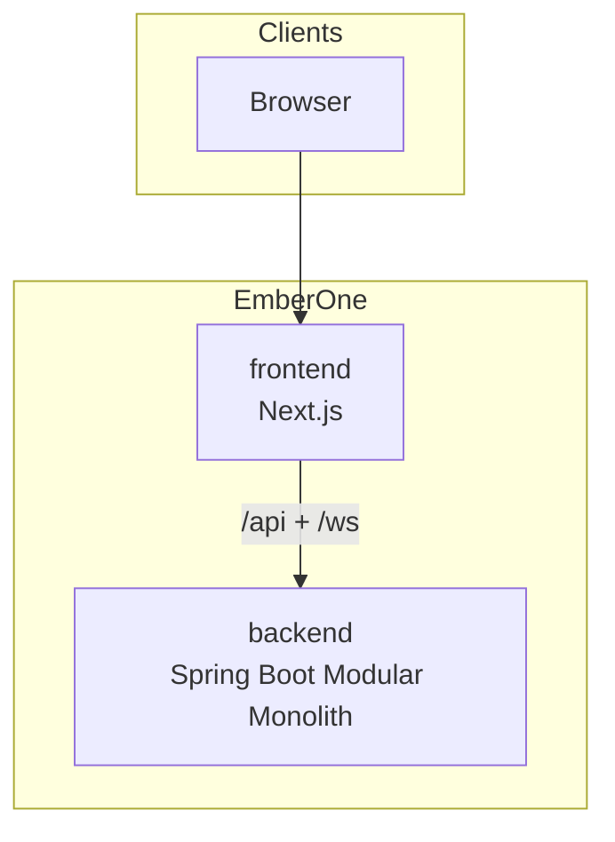

# 5. Bausteinsicht

## 5.1 Whitebox Gesamtsystem

### Begründung

Zwei Deploy-Artefakte (UI und API) halten Frontend- und Backend-Release-Zyklen entkoppelbar, ohne Domänenlogik zu splitten. Die Fachlogik bleibt im Backend-Monolithen; das Frontend orchestriert Darstellung, Auth-Session und Realtime.

### Enthaltene Bausteine

| Baustein | Verantwortung |
|----------|---------------|
| **backend** | REST-API, AuthZ, Domänenlogik, Persistenz, Jobs, Notifications, Realtime-Broker-Anbindung |
| **frontend** | UI, OIDC-Login, Permission-Gating, React Query, STOMP-Client, PWA |

### Wichtige Schnittstellen

- REST unter `/api/v1/...` (Self: `/api/v1/self/...`; Org-/Admin-APIs: `/api/v1/auth/...`)
- WebSocket/STOMP unter `/ws`
- OIDC gegen Authentik (Frontend); JWKS-Validierung (Backend)

## 5.2 Ebene 2 - Backend

Package-Root: `com.emberone`.

### Domänen-Packages

| Package | Verantwortung (kurz) |
|---------|----------------------|
| `organization` | Organisationsbaum, Typen, CRUD |
| `organizationgroup` | Org-Gruppen (`LEADERSHIP`, `ALL_MEMBERS`, `CUSTOM`) |
| `userorganizationmembership` | Org-Mitgliedschaft |
| `userorganizationgroupmembership` | Gruppenmitgliedschaft (`LEADER` / `DEPUTY_LEADER` / `MEMBER`) |
| `user` | User-Stammdaten |
| `identity` | Outbound-Provisioning App→IdP (kein bidirektionaler Sync; derzeit Authentik) |
| `permission` / `permissiongroup` / `permissiongroupmapping` / `userpermission` | Permission-Modell & Auflösung |
| `standard` | Standard-Blueprints, Materialisierung, effektive Auflösung |
| `module` | Module / Standard-Module-Config |
| `workflow` | Generische Engine + Handler-Anbindung |
| `qualification` | Qualifikationskatalog, Übungen, Org-Entscheidungen |
| `certification` | Zertifizierungsdefinitionen/-nachweise |
| `trainingcourse` | Lehrgänge / Kursarten |
| `courseoffering` | Lehrgangsangebote, Zielgruppe, Voraussetzungen, Anmeldung/Warteliste |
| `drivinglicense` | Führerscheine, Klassen, Workflow-Anbindung |
| `rank` / `dutyfunction` | Dienstgrade (Mandantenkatalog, User-Historie) und aufgelöste Funktionen aus Standard-Grants |
| `management` | Management-Modul: Audience-Konfiguration, Aktivierung, Aktivierungsprotokoll |
| `federalstate` | Bundesländer-Stammdaten, Retention-Profile-Anbindung |
| `onboarding` / `onboardingdocument` | Onboarding-Wizard, Eintrittsdokumente |
| `appointment` | Termine, Serien, Antworten |
| `event` | Events / Anwesenheit |
| `absence` | Abwesenheiten |
| `timeentry` | Zeiterfassung |
| `todo` | Aufgaben (u. a. Workflow-Adapter) |
| `notification` | Outbox, Kanäle, Preferences |
| `attachment` / `userdocument` / `profileimage` | Dateien & Dokumente |
| `emergencycontact` | Notfallkontakte |
| `retention` | Löschklassen, Scheduler, Bundesland-Profile |
| `admin` | Plattform-/Tenant-Admin-APIs |

### Querschnitt (`platform`)

| Package | Verantwortung |
|---------|---------------|
| `platform.security` | `SecurityService`, Token, Access-Services; Tenant-Kontext (`TenantContextHolder`/`Support`, WebFilter, JPA-Tx-Manager, Postgres-Session, Admin-Pfad-Interceptor) |
| `platform.domain` | Gemeinsame Lifecycle-Feld-Semantik (`LifecycleFields`) |
| `platform.tenant` | `TenantBatchRunner` (Batch pro Mandant mit Holder-Bind für RLS) |
| `platform.realtime` | STOMP-Config, Topic-Auth, Notifier-Basis |
| `platform.cache` | Redis-/Cache-Infrastruktur |
| `platform.db` | DB-Konfigurationsproperties (`EmberOneDbProperties`) |
| `platform.outbox` | Gemeinsame Outbox-Hilfen (`OutboxBackoff`) |
| `platform.web` | Listen-Infrastruktur (`ListQuery`, `ListDefinition`, `PageDto`, `BoundedList`, Filter-Optionen) |
| `platform.storage` | S3-Client-Abstraktion |
| `platform.mail` | SMTP-Versand |
| `platform.logging` | `RequestIdFilter`, MDC-/ECS-Anbindung |
| `platform.exception` / `exceptionhandler` | Domänenfehler + globale Handler |
| `platform.config` / `http` / `validation` / `i18n` / `navigation` / `event` / `time` / `app` | Infrastruktur-Helfer |

Zentrale Facades mit eigener Concept-Doku: Workflow, Standard, Organization, SecurityService, TokenService, Qualification - siehe [`support/docs/concept/`](../concept/00-index.md).

## 5.3 Ebene 2 - Frontend

App-Router unter `frontend/app/`:

| Routengruppe | Verantwortung |
|--------------|---------------|
| `/auth/*` | OIDC Callback / Silent Callback |
| `/my-area/*` | Self-Service (Workflows, Todos, Dokumente, Zertifikate, Qualifikationen, Zeiterfassung, Abwesenheit, Settings, …) |
| `/organizations/[id]/*` | Org-Kontext (Mitglieder, Gruppen, Workflows, Qualifikationen, …) |
| `/admin/*` | Plattform-/Tenant-Admin: `/admin/users`; unter `/admin/tenants/[id]/…` verschachtelt Standards, Workflows, Organizations, Retention sowie Tenant-Standards (Certs/Training/Org-Types/…) |
| `/serwist`, `/~offline` | PWA / Offline |
| `/verify-notification-email` | E-Mail-Verifikation |

Unterstützende Schichten:

| Bereich | Pfad | Rolle |
|---------|------|-------|
| UI-Primitives | `components/ui/*` | Design-System-Bausteine |
| Feature-UI | `components/{domain}/*` | Domänenspezifische Komponenten |
| Auth/Permissions | `lib/auth/`, `hooks/useAuth`, `lib/permission/` | OIDC/Claims, `useAuth`, `usePermissions` |
| i18n | `hooks/useTranslation`, Locales | Übersetzungen |
| API / Realtime | `lib/` (Clients, STOMP) | Backend-Anbindung |

## 5.4 Ebene 3

Weitere Verfeinerung (Handler pro WorkflowType, Standard-Domain-SPI, Cache-Eviction-Listener) liegt in den Concept-Docs und ist hier bewusst nicht dupliziert.
