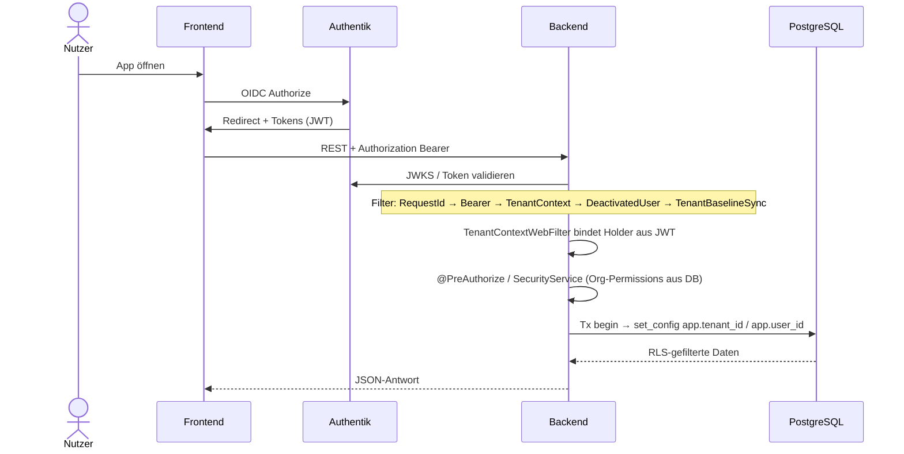
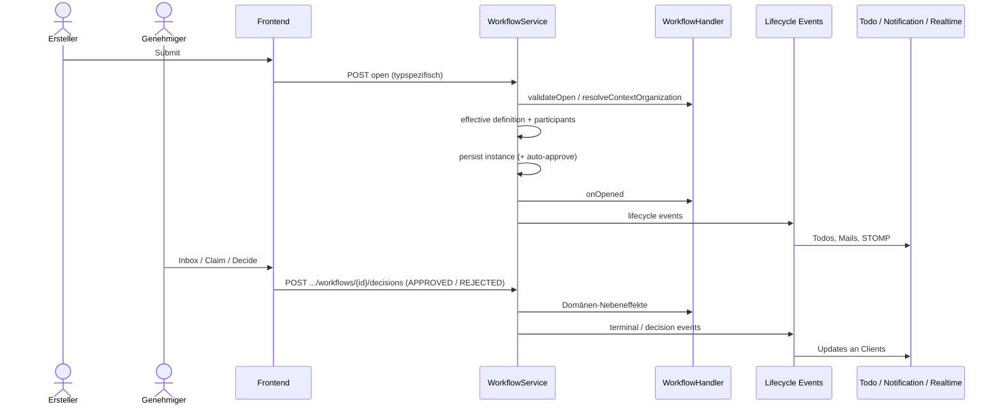
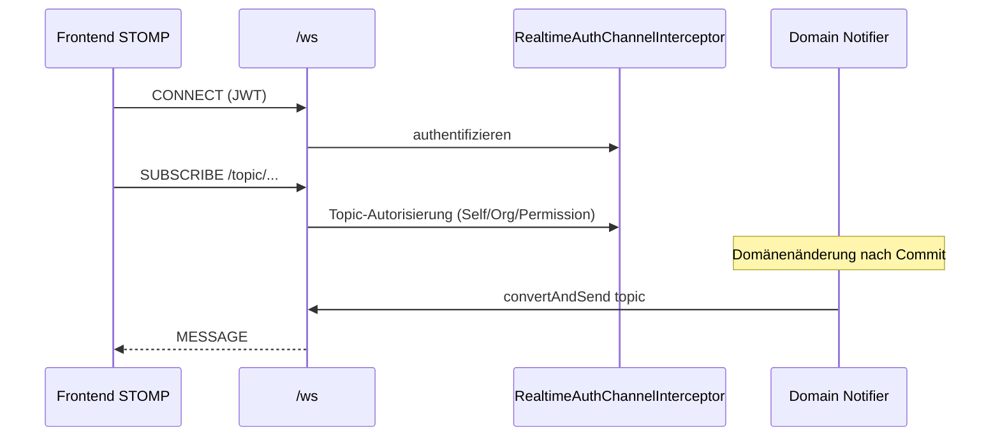

# 6. Laufzeitsicht

Repräsentative End-to-End-Abläufe. Details zu einzelnen Schritten: Concept-Docs.

## 6.1 Login und API-Aufruf (OIDC → JWT → Tenant-Kontext)

**Kernpunkte:** JWT trägt nur `userId`, `tenantId`, `app_role` (keine Gruppen/Org-Permissions). Org-Permissions lädt `SecurityService` serverseitig aus der DB. Der effektive Mandant für Queries ist der Holder-/GUC-Pfad, nicht allein der Claim-Filter in Application-Code. Filter-Reihenfolge und Admin-Pfad-Override: [token-and-tenant-context](../concept/token-and-tenant-context.md).

## 6.2 Workflow öffnen und genehmigen

Beispiel: Nutzer startet einen typisierten Workflow (z. B. Adressänderung / Zertifizierungsantrag); Genehmiger entscheidet.

**Kernpunkte:** Die Engine ist generisch; Fachregeln sitzen im Handler und in Standard-/Org-Mappings. Genehmigung/Ablehnung läuft über `POST /api/v1/auth/workflows/{id}/decisions` (`DecisionType`: `APPROVED` / `REJECTED`), nicht über getrennte Approve-/Reject-Endpunkte. Nebenkanäle hängen an Events, nicht im Engine-Kern. Siehe [workflow-engine](../concept/workflow-engine.md).

## 6.3 Realtime-Subscribe auf Org-/Self-Topics

**Kernpunkte:** Subscribe ist berechtigungspflichtig; Notifier publishen nach Domänenänderungen. Siehe [realtime](../concept/realtime.md).
