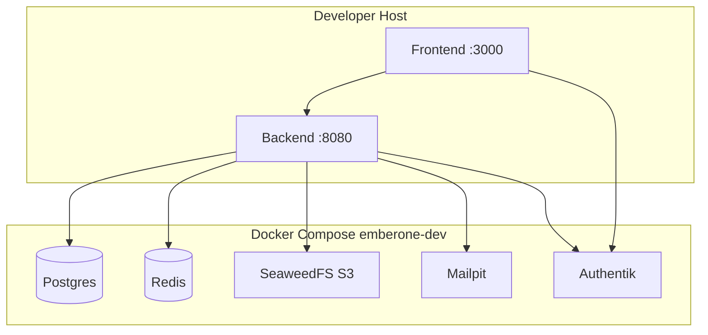

# 7. Verteilungssicht

## 7.1 Infrastruktur Ebene 1

### Lokale Entwicklung (`support/dev/compose`)

`support/dev/compose/docker-compose.dev.yml` stellt Abhängigkeiten bereit; Backend und Frontend laufen typischerweise auf dem Host (`./support/dev/scripts/run-backend.sh`, `bun dev`). Setup: [`support/dev/DEV.md`](../../dev/DEV.md).

| Knoten | Image / Prozess | Ports (Defaults) | Rolle |
|--------|-----------------|------------------|-------|
| **postgres** | `postgres:18-alpine` | 5432 | EmberOne-DB |
| **redis** | `redis:8-alpine` | 6379 | App-Cache |
| **redisinsight** | Redis Insight | 8081→5540 | Cache-UI (Dev) |
| **seaweedfs** | SeaweedFS S3 | 8333, 9333 | Object Storage |
| **mailpit** | Mailpit | 1025 (SMTP), 8025 (UI) | Mail-Catcher (Dev) |
| **authentik-server** | Authentik | 9000 / 9443 | IdP (HTTP/HTTPS nur hier exponiert) |
| **authentik-worker** | Authentik | - | Hintergrundjobs (keine Host-Ports) |
| **authentik-postgresql** | Postgres 18 | intern | Authentik-DB |
| **authentik-redis** | Redis 8 | intern | Authentik |
| **backend** (Host) | Spring Boot | 8080 | API |
| **frontend** (Host) | Next.js | 3000 | UI |

Mail läuft über konfigurierbaren SMTP (`MAIL_*`, `MAIL_SMTP_AUTH`/`MAIL_SMTP_START_TLS` mit Default `true` in Backend-Env). Dev-Compose bringt Mailpit als lokalen Mail-Catcher mit (ohne Auth/TLS); im Betrieb stellt der Betreiber den SMTP-Server.

### Begründung

Abhängigkeiten containerisiert halten Onboarding reproduzierbar; App-Prozesse lokal ermöglichen schnelle Debugger-/Hot-Reload-Zyklen.

### Qualitäts- und Performancemerkmale

- Healthchecks auf Postgres/Redis/SeaweedFS/Authentik-Deps
- Volumes für persistente Dev-Daten; Reset über `./support/dev/scripts/reset-docker.sh`
- Secrets zentral über `./support/dev/setup.sh` → `support/dev/config/.env`, `backend/.env` und `frontend/.env`

### Zuordnung der Bausteine zur Infrastruktur

| Baustein | Dev | CI (dieses Repo) |
|----------|-----|------------------|
| backend | Host-Prozess oder Image | Image-Build (Buildx → GHCR) bei entsprechender Pipeline |
| frontend | `bun dev` / Image | Image-Build (Buildx → GHCR) bei entsprechender Pipeline |
| Postgres / Redis / S3 / Authentik / SMTP | Compose bzw. Plattform | Umgebung vom Betreiber |

## 7.2 Infrastruktur Ebene 2 - Build

Dieses Repository enthält **GitHub Actions**-Pipelines (`.github/workflows/`):

| Job-Gruppe | Jobs | Inhalt |
|------------|------|--------|
| **test** (`ci.yml`) | `copyright-headers`, `commit-messages`, `backend-test`, `frontend-test` | Header-Check; Conventional Commits in PRs und auf `development`/`main`; Gradle build + Jacoco; Biome lint + Next.js build (PRs change-basiert, auf `development`/`main` immer beide Komponenten für Release/Image-Kette) |
| **release** (`ci.yml`) | `release` | Semantic Release: Prerelease `vX.Y.Z-dev.N` auf `development`, stabiles `vX.Y.Z` auf `main` |
| **images** (`ci.yml`) | `release-image` | Docker Buildx → GHCR nur nach veröffentlichtem Release, aus dem Release-Tag; Frontend-Image bäckt Version und Source-URL (AGPL-Angebot in der App) |

Dockerfiles: `backend/docker/Dockerfile`, `frontend/docker/Dockerfile` (Frontend mit Runtime-Config-Entrypoint).

Image-Tags (beide Komponenten, gleiche Version):

| Tag | Wann | Lebensdauer |
|-----|------|-------------|
| `X.Y.Z` bzw. `X.Y.Z-dev.N` | jedes Release | unveränderlich, bleibt (Rollback / AGPL) |
| `X.Y`, `X` (ab Major 1), `latest` | nur stabiles Release auf `main` | beweglich, zeigt auf den neuen Digest |
| `dev` | nur Prerelease auf `development` | beweglich, zeigt auf den neuen Digest |

Produktion auf `X.Y.Z` pinnen; Staging darf `dev`.

### Releases und Image-Tags

- **`development`:** Ein releasbarer Commit (`fix:` Patch, `feat:` Minor, `!` oder `BREAKING CHANGE` Major) erzeugt einen Prerelease `vX.Y.Z-dev.N` mit den Image-Tags `:X.Y.Z-dev.N` und `:dev`.
- **`main`:** Stabile Releases `vX.Y.Z` mit `:X.Y.Z`, `:X.Y`, `:X` und `:latest`, nur über einen Merge-Commit von `development` (kein Squash).
- **Unveränderlich:** Versions-Tags (Produktion darauf pinnen). **Beweglich:** `dev`, `X.Y`, `X`, `latest`.
- **AGPL §13:** Die App verlinkt Version und Quellcode unter `/source`. Forks bauen mit dem Build-Arg `SOURCE_REPO` auf das eigene Repo.

Produktions-Deploy (Orchestration, Secrets, Ingress) liegt **außerhalb** dieses Repos und ist betreiberspezifisch.
